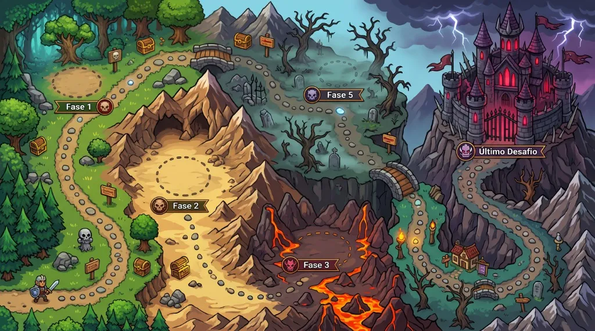

# ⚔️ RPG em Flutter — Circuito de Batalhas

Um jogo de **RPG Tático e Card Battler em Turnos** desenvolvido com **Flutter** e **Firebase**. Crie seu herói, equipe armas e armaduras no Mercador da Vila explorando o sistema de afinidade de classes, escolha seu cenário de combate e avance por um **Circuito de Chefes** usando cartas de ataque, magia e itens!



---

## 🎮 Mecânicas do Jogo

### 🗺️ Circuito de Batalhas Progressivo
A campanha é estruturada em um mapa de circuito interativo onde seu herói avança fase a fase derrotando os chefes que ameaçam o reino:
1. **Fase 1 (Floresta)** — *Goblin Traiçoeiro* (`110 HP` | `14 ATK` | `2 DEF`)
2. **Fase 2 (Caverna/Deserto)** — *Orc das Montanhas* (`170 HP` | `20 ATK` | `4 DEF`)
3. **Fase 3 (Cratera de Lava)** — *Dragão-Cospe-Fogo* (`240 HP` | `26 ATK` | `6 DEF`)
4. **Fase 4 (Cemitério Sombrio)** — *Bruxa Malvada* (`300 HP` | `32 ATK` | `7 DEF`)
5. **Desafio Final (Castelo Sombrio)** — *Esqueleto Maldito* (`380 HP` | `38 ATK` | `9 DEF`)

- Cada fase superada desbloqueia a próxima etapa do circuito.
- Durante o combate, uma trilha superior exibe sua posição no circuito em tempo real.
- Ao derrotar um chefe, a **Tela de Vitória** exibe o resumo de XP, Ouro ganho, evolução de nível (*Level Up*), drops de equipamentos da `lootTable` do chefe e permite **avançar diretamente** para a próxima fase do circuito.

### 🃏 Sistema de Combate por Cartas (Drag & Drop)
- **Cartas de Ataque Físico**: Arraste sobre o inimigo para causar dano físico baseado no seu `ATK` contra a `DEF` do chefe, com **25% de chance de Acerto Crítico (2x dano)**.
- **Cartas de Magia (Bola de Fogo)**: Consome `15 de Mana` para causar `2.5x` o ataque do herói em dano mágico direto.
- **Cartas de Item (Poções)**: As poções da sua mochila entram automaticamente no seu baralho de batalha; arraste-as sobre o seu próprio herói para restaurar HP no meio da luta.
- **Troca de Mão (Reroll)**: Permite descartar a mão atual e comprar novas cartas até 5 vezes por combate.

### 🛡️ Classes de Heróis e Afinidade de Equipamentos
Crie múltiplos heróis escolhendo nome, avatar e uma das **5 classes**, cada uma com bônus de afinidade próprios ao equipar itens da mochila:
- **Guerreiro**: Bônus (`1.3x`) com Espadas, Machados, Escudos e Armaduras.
- **Paladino**: Bônus (`1.35x`) com Espadas, Escudos, Armaduras e Anéis.
- **Mago**: Bônus (`1.5x`) com Cajados Místicos, Anéis e Poções.
- **Ladino**: Bônus (`1.4x`) com Adagas, Arcos e Armaduras Leves.
- **Caçador**: Bônus (`1.4x`) com Arcos, Adagas e Poções.

### 💰 Mercador da Vila e Mochila
- Novos aventureiros iniciam a jornada com **50 moedas de Ouro**.
- Compre poções, armas, escudos, cajados, armaduras e anéis no **Mercador da Vila**.
- Gerencie sua mochila (limite estratégico de até 5 itens ativos que concedem bônus automáticos nas batalhas).

---

## 🛠️ Tecnologias e Otimizações

- **[Flutter](https://flutter.dev/) & Dart 3**: Interface reativa, animações (`AnimatedSwitcher`, `AnimatedAlign`, `InteractiveViewer`, `CustomPainter`) e suporte multiplataforma (Web, Android, iOS e Desktop).
- **[Provider](https://pub.dev/packages/provider)**: Gerenciamento de estado reativo (`AuthProvider` e `GameState` via `ChangeNotifierProxyProvider`).
- **[Firebase Authentication](https://firebase.google.com/docs/auth)**: Cadastro e login de jogadores com e-mail e senha.
- **[Firebase Realtime Database](https://firebase.google.com/docs/database)**: Sincronização em nuvem em tempo real de heróis criados, nível/XP, ouro, inventário e progresso nas fases do circuito.
- **[AudioPlayers](https://pub.dev/packages/audioplayers)**: Trilha sonora ambiente, música tema de batalha e efeitos sonoros de compra.
- **[Shared Preferences](https://pub.dev/packages/shared_preferences)**: Persistência local do último herói selecionado por usuário.
- **Assets Otimizados em WebP**: Todas as texturas, avatares, cartas e cenários utilizam compressão `.webp` para carregamento rápido e baixo consumo de memória.

---

## 📂 Estrutura do Projeto

```text
rpg_em_flutter/
└── game/
    ├── assets/
    │   ├── images/          # Cenários, mapa do circuito, heróis, chefes e itens (.webp)
    │   └── sounds/          # Músicas de fundo e efeitos sonoros (.mp3)
    └── lib/
        ├── main.dart        # Inicialização do Flutter e Firebase
        ├── app/             # Configuração do MaterialApp e MultiProvider
        ├── data/
        │   ├── enums/       # Tipos de ações de cartas e logs de batalha
        │   ├── local/       # Catálogo de chefes, missões, itens e heróis padrão
        │   └── models/      # Modelos de Herói, Inimigo, Carta, Item, Missão e Usuário
        ├── providers/       # AuthProvider e GameState (sincronização com Firebase)
        ├── screens/         # Telas (Login, Cadastro, Home, Heróis, Loja, Cenários, Circuito e Batalha)
        ├── services/        # AudioManager (controle de BGM e SFX)
        └── widgets/         # Componentes visuais reutilizáveis
```

---

## 🚀 Como Executar o Projeto

### Pré-requisitos
- [Flutter SDK](https://docs.flutter.dev/get-started/install) (`>=3.3.0`)

### Passo a Passo

1. **Clone o repositório:**
   ```bash
   git clone https://github.com/seu-usuario/rpg_em_flutter.git
   cd rpg_em_flutter/game
   ```

2. **Instale as dependências:**
   ```bash
   flutter pub get
   ```

3. **Execute o jogo:**
   ```bash
   flutter run
   ```
   *(Para rodar no navegador Chrome: `flutter run -d chrome`)*

---

Desenvolvido com 💙 e Flutter.
